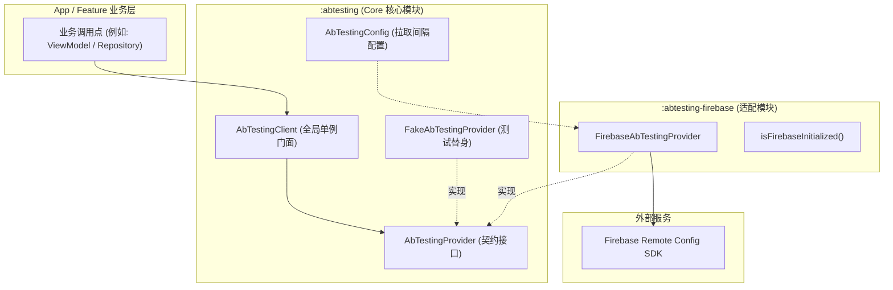
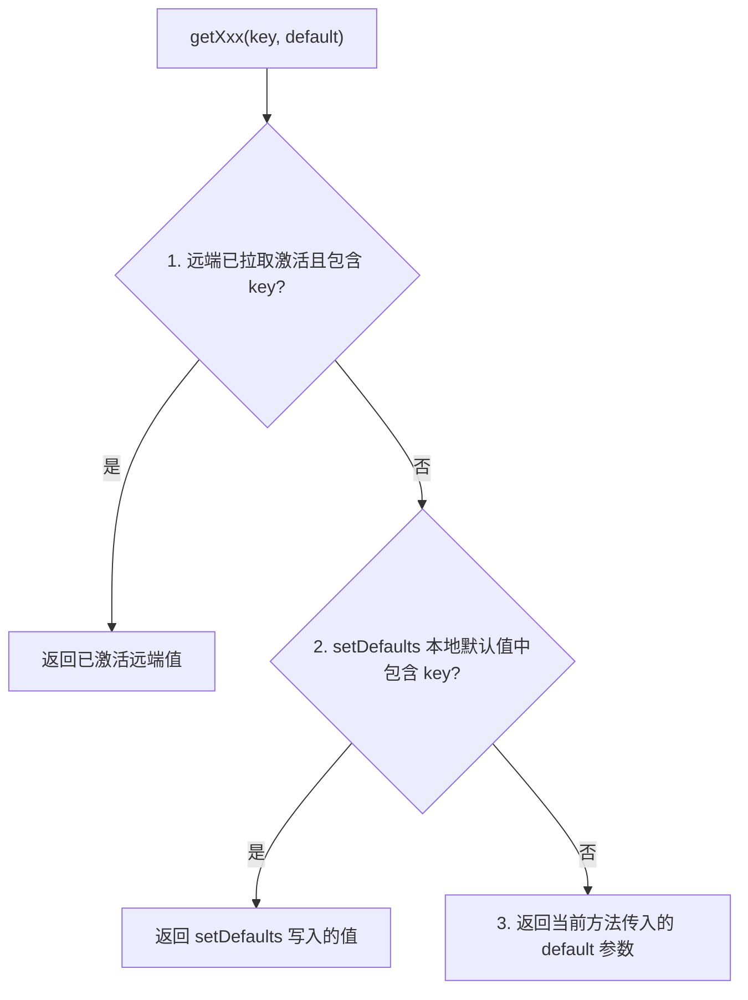

# AbTestingKit-Android

[](https://github.com/e-hai/AbTestingKit-Android/releases)
[](https://github.com/e-hai/AbTestingKit-Android/packages)
[](LICENSE)
[]()

轻量级 Android A/B Testing / Remote Config 门面封装库。业务代码仅依赖统一稳定 API，当需要更换或新增配置后端（如 Firebase、GrowthBook、自研后台）时，只需替换适配模块，业务调用点零改动。

---

## 架构设计



### 模块说明

| 模块 | 说明 | 外部依赖 |
| :--- | :--- | :--- |
| [`:abtesting`](abtesting/) | **Core 核心**：包含 `AbTestingClient`、`AbTestingProvider`、`FakeAbTestingProvider`、`AbTestingConfig` | 仅依赖协程核心库，**零第三方厂商依赖** |
| [`:abtesting-firebase`](abtesting-firebase/) | **Firebase 适配器**：对接 Firebase Remote Config SDK | `firebase-config`、`play-services-coroutines` |
| [`:sample`](sample/) | **演示工程**：基于 Jetpack Compose 构建的完整功能演练场 | 无 Firebase 时自动降级为 Fake 运行 |

---

## 取值优先级

读取配置项时，严格遵循以下三层优先级策略，命中即返回：



1. **已激活的远端值**：调用 `fetchAndActivate()` 成功后从服务器同步并激活的最新值。
2. **本地兜底默认值**：通过 `setDefaults(map)` 设置的兜底字典，保障首次启动未联网或远端缺少 key 时界面正常展示。
3. **方法入参默认值**：调用 `get*(key, default)` 时传入的兜底参数，防范未定义 key。

---

## 快速接入（GitHub Packages）

> **重要说明**：GitHub Packages 即使是公开仓库也要求携带鉴权凭证拉取依赖，开发者需先配置只读 `read:packages` Token。

### 1. 配置 GitHub Packages 凭证

前往 GitHub [Personal Access Tokens (classic)](https://github.com/settings/tokens) 生成一个具备 **`read:packages`** 权限的 Token，然后选择以下任一方式配置（切勿将 Token 提交到 Git）：

* **方式 A（推荐，全局生效）**：在本地 `~/.gradle/gradle.properties` 中添加：
  ```properties
  gpr.user=你的GitHub用户名
  gpr.key=你的GitHub_PAT_Token
  ```
* **方式 B（CI/CD 环境变量）**：配置环境变量 `GITHUB_ACTOR` 与 `GITHUB_TOKEN`（GitHub Actions 中可直接使用内置 `${{ secrets.GITHUB_TOKEN }}`）。

### 2. 添加 GitHub Packages 仓库

在消费方项目的 `settings.gradle.kts` 中配置仓库：

```kotlin
dependencyResolutionManagement {
    repositories {
        google()
        mavenCentral()
        maven {
            name = "GitHubPackages"
            url = uri("https://maven.pkg.github.com/e-hai/AbTestingKit-Android")
            credentials {
                username = providers.gradleProperty("gpr.user")
                    .orElse(providers.environmentVariable("GITHUB_ACTOR"))
                    .orNull
                password = providers.gradleProperty("gpr.key")
                    .orElse(providers.environmentVariable("GITHUB_TOKEN"))
                    .orNull
            }
        }
    }
}
```

> 若希望把凭证放在项目的 `local.properties`（已被 `.gitignore` 忽略），可在 `settings.gradle.kts` 中通过 `java.util.Properties` 读取并赋值给 `username` / `password`。

### 3. 引入依赖

根据项目需求在 `app/build.gradle.kts` 中添加：

```kotlin
dependencies {
    // 方案 A：使用 Firebase 适配器（推荐，会自动传递依赖 com.kit.abtesting:abtesting）
    implementation("com.kit.abtesting:abtesting-firebase:1.0.1")

    // 方案 B：仅引入 Core（自研后端或纯本地验证）
    // implementation("com.kit.abtesting:abtesting:1.0.1")
}
```

> **注意**：本库遵循控制反转原则，**不会在库内部自动初始化 Firebase**。接入宿主应用需按照官方流程配置 `google-services` 插件及 `google-services.json`。

### 4. 初始化与拉取

推荐在 `Application.onCreate` 或启动任务流中配置：

```kotlin
class MyApp : Application() {
    override fun onCreate() {
        super.onCreate()

        // 1. 安装适配器
        AbTestingClient.install(
            FirebaseAbTestingProvider(
                context = this,
                config = AbTestingConfig(
                    // 生产建议 3600L+；Debug 环境可设为 0L 以便即时测试
                    minimumFetchIntervalInSeconds = if (BuildConfig.DEBUG) 0L else 3600L
                )
            )
        )

        // 2. 注册本地默认兜底值
        CoroutineScope(Dispatchers.Main).launch {
            AbTestingClient.setDefaults(
                mapOf(
                    "feature_x" to false,
                    "welcome_message" to "欢迎使用我们的 App",
                    "max_items" to 10L,
                    "score_threshold" to 0.75
                )
            )

            // 3. 异步拉取并激活远端配置
            val activated = AbTestingClient.fetchAndActivate()
            Log.d("AbTesting", "远端配置激活状态: $activated")
        }
    }
}
```

### 5. 读取配置

在任意业务层调用点，直接面向 `AbTestingClient` 读取：

```kotlin
// 读取布尔开关
val isFeatureXEnabled = AbTestingClient.getBoolean("feature_x", false)

// 读取文案字符串
val welcome = AbTestingClient.getString("welcome_message", "默认欢迎语")

// 读取长整数数值
val maxCount = AbTestingClient.getLong("max_items", 10L)

// 读取浮点数数值
val threshold = AbTestingClient.getDouble("score_threshold", 0.5)
```

---

## 进阶与最佳实践

### 单元测试与离线验证

在单测模块中，使用内置的 `FakeAbTestingProvider`，无需依赖 Android Context、网络或 Firebase：

```kotlin
class HomeViewModelTest {

    private val fakeProvider = FakeAbTestingProvider()

    @Before
    fun setUp() {
        AbTestingClient.install(fakeProvider)
    }

    @After
    fun tearDown() {
        AbTestingClient.reset() // 重置全局状态，避免测试用例污染
    }

    @Test
    fun testFeatureFlagFlow() = runBlocking {
        // 设置默认值
        AbTestingClient.setDefaults(mapOf("feature_x" to false))
        assertFalse(AbTestingClient.getBoolean("feature_x", false))

        // 模拟远端推送新开关
        fakeProvider.setRemoteValues(mapOf("feature_x" to true))
        
        // 激活前仍为 false
        assertFalse(AbTestingClient.getBoolean("feature_x", false))

        // 激活后覆盖默认值
        AbTestingClient.fetchAndActivate()
        assertTrue(AbTestingClient.getBoolean("feature_x", false))
    }
}
```

### 自定义 Provider 实现

若要对接自研后台或其他第三方服务，只需实现 `AbTestingProvider` 接口：

```kotlin
class CustomServerAbTestingProvider(
    private val apiClient: MyApiClient
) : AbTestingProvider {

    override suspend fun setDefaults(defaults: Map<String, Any>) {
        // 写入本地缓存或内存
    }

    override suspend fun fetchAndActivate(): Boolean {
        val config = apiClient.fetchConfig()
        // 存入已激活存储区
        return true
    }

    override fun getBoolean(key: String, default: Boolean): Boolean = ...
    override fun getString(key: String, default: String): String = ...
    override fun getLong(key: String, default: Long): Long = ...
    override fun getDouble(key: String, default: Double): Double = ...
}
```

---

## 从 JitPack 迁移到 GitHub Packages

如果旧项目曾使用 JitPack 引用，请按如下对照修改：

| 项目 | 旧配置（JitPack） | 新配置（GitHub Packages） |
| :--- | :--- | :--- |
| **仓库地址** | `https://jitpack.io` | `https://maven.pkg.github.com/e-hai/AbTestingKit-Android`（需鉴权） |
| **Firebase 坐标** | `com.github.e-hai.AbTestingKit-Android:abtesting-firebase:<ver>` | `com.kit.abtesting:abtesting-firebase:<ver>` |
| **Core 坐标** | `com.github.e-hai.AbTestingKit-Android:abtesting:<ver>` | `com.kit.abtesting:abtesting:<ver>` |

API 与包名（`com.kit.abtesting.*`）完全保持不变，业务代码无需任何修改。

---

## 演示工程 (Sample)

克隆本项目并在 Android Studio 中直接运行 `:sample` 模块：
- **无 Firebase 配置**：自动优雅降级为 `FakeAbTestingProvider`，开箱即用体验数据变化与动画。
- **对接真实 Firebase**：将 `google-services.json` 放入 `sample/` 目录，在 `sample/build.gradle.kts` 中应用 `com.google.gms.google-services` 插件即可。

---

## 发布新版本（维护者指南）

本项目已配置 [`.github/workflows/publish.yml`](.github/workflows/publish.yml) 与 [`gradle/maven-publish.gradle.kts`](gradle/maven-publish.gradle.kts)：

### 自动发布（推荐）
推送版本 Tag（如 `1.0.1` 或 `v1.0.1`）后，GitHub Actions 将自动运行单测并发布至 GitHub Packages：
```bash
git tag -a 1.0.1 -m "Release 1.0.1"
git push origin 1.0.1
```
也可以在 GitHub 仓库的 **Actions > Publish to GitHub Packages** 中点击 **Run workflow** 手动触发。

### 本地手动发布 / 校验
```bash
# 1. 发布到本地 Maven (~/.m2/repository/com/kit/abtesting/) 进行验证
./gradlew :abtesting:publishReleasePublicationToMavenLocal \
  :abtesting-firebase:publishReleasePublicationToMavenLocal \
  --no-configuration-cache

# 2. 手动推送至 GitHub Packages（需配置具备 write:packages 权限的 gpr.user/gpr.key 或 GITHUB_TOKEN）
./gradlew :abtesting:publishReleasePublicationToGitHubPackagesRepository \
  :abtesting-firebase:publishReleasePublicationToGitHubPackagesRepository \
  --no-configuration-cache
```

---

## License

```text
Copyright 2026 e-hai

Licensed under the Apache License, Version 2.0 (the "License");
you may not use this file except in compliance with the License.
You may obtain a copy of the License at

    http://www.apache.org/licenses/LICENSE-2.0
```
