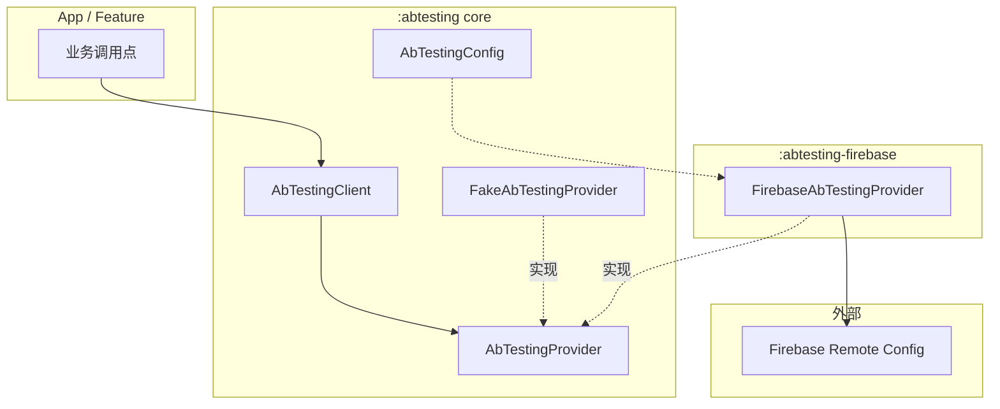
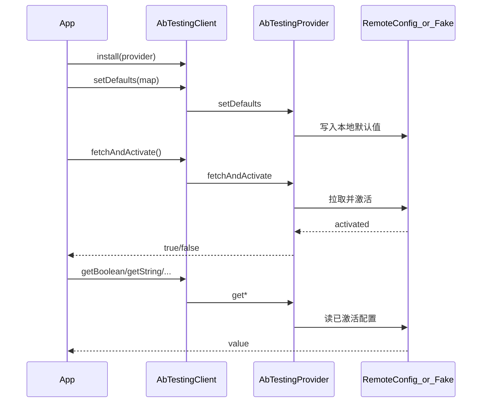
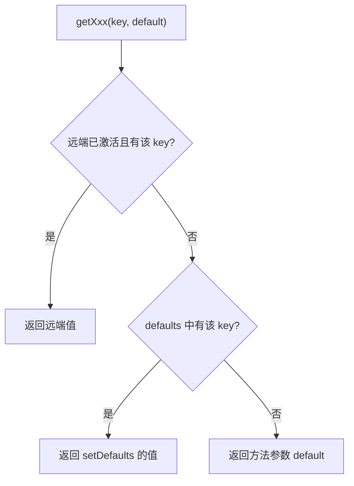

# AbTestingKit

Android A/B Testing / Remote Config 封装库。业务只依赖稳定 API，换后端时替换实现模块即可。

## 架构



| 模块 | 说明 |
|------|------|
| `:abtesting` | Core：`AbTestingClient` / `AbTestingProvider` / `FakeAbTestingProvider`（测试替身） |
| `:abtesting-firebase` | Firebase Remote Config 实现 |
| `:sample` | 演示 App（无 Firebase 时用 Fake 跑通流程） |

业务只面向 `AbTestingClient`；换后端时换 `AbTestingProvider` 实现模块，调用点不用改。

## 使用场景

| 场景 | 用什么 | 说明 |
|------|--------|------|
| 正式 App 接远端配置 | `FirebaseAbTestingProvider` | 宿主完成 Firebase 初始化后 `install` |
| 单元测试 | `FakeAbTestingProvider` | 测试替身：不依赖网络 / Firebase，断言 defaults 与模拟远端 |
| sample 无 Firebase 时本地验证 | `FakeAbTestingProvider` | 仅用于跑通 API；非正式生产实现 |
| 启动兜底 | `setDefaults` | 远端未就绪或 key 缺失时仍有合理值 |

`FakeAbTestingProvider` 是测试替身，提供 `setRemoteValues` 模拟远端下发；调用 `fetchAndActivate()` 后这些值才会覆盖 defaults（与真实 Provider 的「拉取再激活」节奏一致）。

## 调用流程

### 推荐生命周期



### 取值优先级

读某个 key 时，从上到下命中即返回：

1. **已激活的远端值**（`fetchAndActivate` 成功后生效）
2. **`setDefaults` 写入的本地默认值**
3. **getter 方法参数里的 `default`**（key 完全未定义时的最后兜底）



### `setDefaults` 是什么

`setDefaults` 设置**本地兜底默认值**，不是远端配置本身。

常见用途：

- App 一启动就要读开关，但网络 / 拉取尚未完成
- 远端暂时没有某个 key，避免读到空串 / `false` / `0` 等「无意义」的隐式值
- 与 Firebase Remote Config 的 defaults 语义对齐，便于以后换后端仍保持同一心智模型

典型顺序：**install → setDefaults → fetchAndActivate → get\***。先 defaults 再 fetch，保证拉取前后都有可读值。

## 快速接入

### 1. 依赖

```kotlin
// app/build.gradle.kts
dependencies {
    implementation(project(":abtesting-firebase")) // 传递依赖 :abtesting
}
```

宿主 App 需自行初始化 Firebase（`google-services` 插件 + `google-services.json`）。本库**不会**初始化 `FirebaseApp`。

### 2. 安装与拉取

```kotlin
AbTestingClient.install(
    FirebaseAbTestingProvider(
        context = applicationContext,
        config = AbTestingConfig(minimumFetchIntervalInSeconds = 3600L),
    ),
)

AbTestingClient.setDefaults(
    mapOf(
        "feature_x" to false,
        "welcome_message" to "Hello",
        "max_items" to 10L,
        "score_threshold" to 0.75,
    ),
)

val activated = AbTestingClient.fetchAndActivate()
```

Debug 可将 `minimumFetchIntervalInSeconds` 设为 `0`，便于频繁拉取。

### 3. 读取配置

```kotlin
val enabled = AbTestingClient.getBoolean("feature_x", false)
val title = AbTestingClient.getString("welcome_message", "")
val count = AbTestingClient.getLong("max_items", 0L)
val threshold = AbTestingClient.getDouble("score_threshold", 0.0)
```

### 4. 测试用 Fake

```kotlin
val fake = FakeAbTestingProvider().apply {
    setRemoteValues(mapOf("feature_x" to true))
}
AbTestingClient.install(fake)
AbTestingClient.setDefaults(mapOf("feature_x" to false))
AbTestingClient.fetchAndActivate() // 之后 feature_x == true
```

## Sample

运行 `:sample`：

- 未配置 Firebase 时使用 `FakeAbTestingProvider`，可直接看到演示值
- 接真实 Remote Config：
  1. 将 `google-services.json` 放到 `sample/`
  2. 在 `sample/build.gradle.kts` 应用 `com.google.gms.google-services`
  3. 重新编译运行

## 通过 JitPack 使用

1. 将本仓库推到 GitHub，并把 [`gradle.properties`](gradle.properties) 里的 `OWNER` 换成你的 GitHub 用户名/组织名  
2. 打 tag 并 push（例如 `v0.1.0`）  
3. 打开 [jitpack.io](https://jitpack.io)，填入仓库地址，等构建变绿  

消费方 `settings.gradle.kts`：

```kotlin
dependencyResolutionManagement {
    repositories {
        google()
        mavenCentral()
        maven { url = uri("https://jitpack.io") }
    }
}
```

依赖（把 `OWNER` / 版本换成实际值）：

```kotlin
// 仅用 Firebase 实现（会传递依赖 core）
implementation("com.github.OWNER.AbTestingKit:abtesting-firebase:0.1.0")

// 或只要 core（自行提供 AbTestingProvider）
implementation("com.github.OWNER.AbTestingKit:abtesting:0.1.0")
```

本地校验发布：

```bash
./gradlew :abtesting:publishReleasePublicationToMavenLocal \
  :abtesting-firebase:publishReleasePublicationToMavenLocal \
  --no-configuration-cache
```

产物会出现在 `~/.m2/repository/com/github/OWNER/AbTestingKit/`。

## 测试

```bash
./gradlew :abtesting:testDebugUnitTest
```

Core 单测覆盖 `AbTestingClient` 与 `FakeAbTestingProvider`。

## 当前范围（v1）

已支持：初始化、本地默认值、`fetchAndActivate`、Boolean/String/Long/Double 读取、JitPack 发布配置。

暂未包含：实验 variant / 曝光上报、配置变更 Flow、用户属性。

## 技术说明

- AGP 9 内置 Kotlin，library 模块无需再应用 `org.jetbrains.kotlin.android`
- Firebase 使用 BoM + `firebase-config`（主模块，不再使用已移除的 `*-ktx`）
- 发布脚本见 [`gradle/jitpack-publish.gradle.kts`](gradle/jitpack-publish.gradle.kts)，JitPack 入口见 [`jitpack.yml`](jitpack.yml)
- 版本目录见 [`gradle/libs.versions.toml`](gradle/libs.versions.toml)
